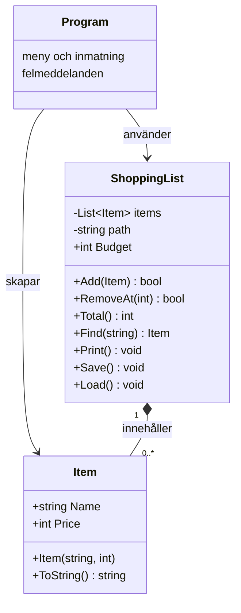

# Robust inköpslista

Ett konsolprogram i C# med sparning och budgettak på 1 000 kr. Kräver .NET 10 SDK. Kör `dotnet run` från projektmappen. Priser anges i hela kronor. Välj 3 för att spara innan du avslutar. Filen `items.txt` ligger i den aktuella arbetsmappen.

## Felrapport – sex fel

1. **Krasch vid inläsning.** `Split('\n')` gav en tom sista rad, som saknade `parts[1]`. `ReadAllLines` och kontroll av tomma rader, antal delar och `TryParse` gör inläsningen robust. Det gamla sättet lämnade också kvar `\r` i namnet på Windows, så sökning efter den synliga varan misslyckades. Radsluten tas nu bort och namn trimmas. Sökningen ignorerar dessutom stora och små bokstäver.
2. **Krasch vid felaktiga tal.** `int.Parse` kastade undantag för bokstäver, tom inmatning och för stora tal i meny, pris och nummer. `int.TryParse` kontrollerar nu inmatningen och användaren får ett meddelande. Slut på inmatningsströmmen avslutar programmet.
3. **Krasch vid borttagning.** `RemoveAt(number - 1)` anropades även för nummer som inte fanns. Metoden kontrollerar nu intervallet och returnerar `false` vid ett ogiltigt nummer.
4. **Krasch när filen saknades.** `File.ReadAllText` kastade `FileNotFoundException`. Programmet fångar nu detta och börjar med en tom lista. Även läsfel och nekad åtkomst får begripliga meddelanden.
5. **Fel totalsumma.** Loopen började på index 1 och missade första varan. `foreach` summerar nu alla varor. Ursprungliga listans summa är 15 + 32 + 89 = 136 kr.
6. **Dolt sparfel.** En tom `catch` dolde felet och programmet skrev ändå att listan var sparad. `Save` låter nu felet nå Program.cs, som fångar `IOException` och `UnauthorizedAccessException`. Bekräftelsen skrivs bara efter lyckad sparning.

## Designval

`Item` kastar `ArgumentException` för ett tomt eller blankt namn och `ArgumentOutOfRangeException` för negativt pris. Egenskaperna är skrivskyddade, så ett giltigt objekt inte kan göras ogiltigt i efterhand. Program.cs fångar undantagen och fortsätter köra.

`ShoppingList.Add` returnerar `false` när varan skulle överskrida budgeten. Detta är en väntad situation som anroparen enkelt kan hantera med `if`. Program.cs måste kontrollera svaret och tala om att varan inte lades till. Exakt budgetgräns tillåts. Jämförelsen använder återstående budget för att undvika heltalsöverflöde vid stora priser.

Inläsningen använder samma Add-metod, så budgeten gäller även sparade varor. Felaktiga rader eller varor över budget hoppas över med ett meddelande. En senare sparning innehåller bara accepterade varor. Filformatet är `pris;namn`; delning sker bara vid första semikolonet, så namn med semikolon kan läsas tillbaka. Ingen catch är tom eller fångar enbart Exception.

## Klassdiagram

Program.cs använder toppnivåsatser; Program skapas av kompilatorn.

## Förstå lösningen

Följ en vara från inmatningen: TryParse kontrollerar att priset är ett heltal, konstruktorn kontrollerar att värdena är giltiga och Add kontrollerar budgeten. Dessa kontroller har olika ansvar. Save skriver filen; Program.cs ansvarar för meddelandet till användaren.

Läs igenom koden och förklara med egna ord varför en ogiltig vara ger ett undantag medan överskriden budget ger false, hur listans nummer översätts till index och varför sparbekräftelsen ligger efter Save.

## GitHub

Projektet har lokal Git-historik med orörd startkod i första commiten. Det är ännu inte publicerat. Öppna projektmappen i VS Code och välj **Publish to GitHub**, sedan publikt repo. Kontrollera länken i en inkognitoflik. Commits skapade med assistans använder tills vidare namnet Student och adressen student@localhost; ställ in dina egna Git-uppgifter för fortsatt arbete. Historiken visar assistentens arbetssteg och ska inte beskrivas som eget manuellt arbete. Läs och förstå lösningen före inlämning.

`bin/` och `obj/` är gitignorade.

## Verifiering

`dotnet build` lyckades med 0 fel och 0 varningar. Före sista UTF-8-ändringen verifierades felaktig meny/pris/nummer, saknad fil, tomt namn, negativt pris, exakt budget och avvisat för stort pris. Omstartstestet upptäckte teckenkodningsproblemet, vilket ledde till UTF-8-ändringen. Den senaste versionen kunde byggas, men Windows Application Control blockerade körningen av den nya Shopping.dll. Därför är fullständig omstart/sökning och sparfel ännu inte verifierade i senaste versionen.

Kontrollera lokalt med `dotnet run`: lägg till Mjölk, spara, avsluta, starta om och sök på mjölk. Kontrollera summan 136 kr i startlistan. Testa bokstäver, mycket stora tal, negativt pris, tomt namn och ogiltiga nummer. Testa en vara som når budgeten exakt och en som överskrider den. Testa även felaktiga filrader och att ett sparfel aldrig ger beskedet att listan är sparad.
