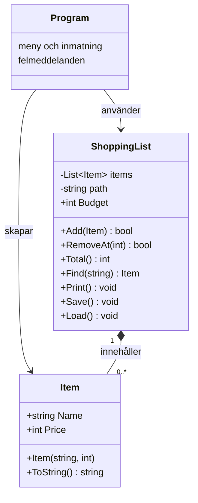

## Felrapport – sex fel

1. **Krasch vid inläsning.** `Split('\n')` gav en tom sista rad, som saknade `parts[1]`. `ReadAllLines` och kontroll av tomma rader, antal delar och `TryParse` gör inläsningen robust. Det gamla sättet lämnade också kvar `\r` i namnet på Windows, så sökning efter den synliga varan misslyckades. Radsluten tas nu bort och namn trimmas. Sökningen ignorerar dessutom stora och små bokstäver.
2. **Krasch vid felaktiga tal.** `int.Parse` kastade undantag för bokstäver, tom inmatning och för stora tal i meny, pris och nummer. `int.TryParse` kontrollerar nu inmatningen och användaren får ett meddelande. Slut på inmatningsströmmen avslutar programmet.
3. **Krasch vid borttagning.** `RemoveAt(number - 1)` anropades även för nummer som inte fanns. Metoden kontrollerar nu intervallet och returnerar `false` vid ett ogiltigt nummer.
4. **Krasch när filen saknades.** `File.ReadAllText` kastade `FileNotFoundException`. Programmet fångar nu detta och börjar med en tom lista. Även läsfel och nekad åtkomst får begripliga meddelanden.
5. **Fel totalsumma.** Loopen började på index 1 och missade första varan. `foreach` summerar nu alla varor. Ursprungliga listans summa är 15 + 32 + 89 = 136 kr.
6. **Dolt sparfel.** En tom `catch` dolde felet och programmet skrev ändå att listan var sparad. `Save` låter nu felet nå Program.cs, som fångar `IOException` och `UnauthorizedAccessException`. Bekräftelsen skrivs bara efter lyckad sparning.

## Designval

`Item` kastar `ArgumentException` för ett tomt eller blankt namn och `ArgumentOutOfRangeException` för negativt pris. Egenskaperna är skrivskyddade, så ett giltigt objekt inte kan göras ogiltigt i efterhand. Program.cs fångar undantagen och fortsätter köra.

`ShoppingList.Add` returnerar `false` när varan skulle överskrida budgeten. Detta är en väntad situation som anroparen enkelt kan hantera med `if`. Program.cs måste kontrollera svaret och tala om att varan inte lades till. Exakt budgetgräns tillåts. Jämförelsen använder återstående budget för att undvika heltalsöverflöde vid stora priser.

Inläsningen använder samma Add-metod, så budgeten gäller även sparade varor. Felaktiga rader eller varor över budget hoppas över med ett meddelande. En senare sparning innehåller bara accepterade varor. Filformatet är `pris;namn`; delning sker bara vid första semikolonet, så namn med semikolon kan läsas tillbaka. Ingen catch är tom eller fångar enbart Exception.

## Klassdiagram

Program.cs använder toppnivåsatser; Program skapas av kompilatorn.

